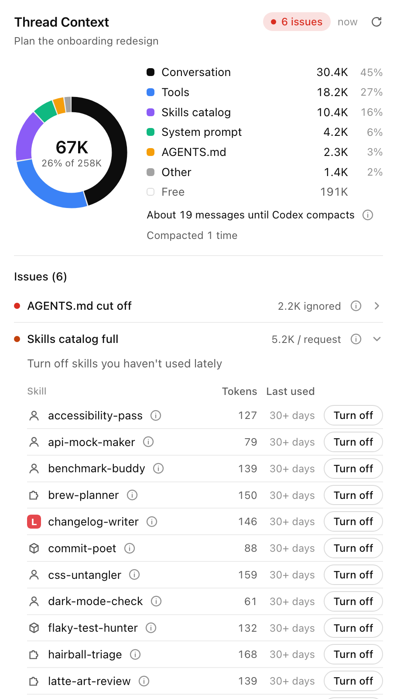

# Codex Context Dev

Development fork of [Codex Context](https://github.com/nnixaa/codex-context-plugin), distributed under its MIT license. The plugin shows what fills a Codex thread's context.



## What it shows

- **What's in context.** The conversation, tools, the skills catalog, Codex's system prompt and AGENTS.md, as a chart of the latest request.
- **Turn history.** The sidebar shows the first sentence of the user's prompt, shortened to fit, with elapsed time and the change in input tokens below it. Prompt titles are exclusive to the sidebar. Timing starts when Codex begins processing, includes tool calls and waits, and updates for the unfinished latest turn. The list starts with five turns and can load earlier ones. Open each turn for its number, recorded start, status, input count, and largest recorded text items. MCP results show the server and tool where the transcript provides enough information.
- **Copy /compact.** Copies the native command so you can paste it into the chat and run it. If clipboard access is unavailable, type `/compact` in the chat.
- **Messages until compaction.** About how many more messages fit before Codex compacts the thread and keeps only a summary.
- **Issues.** Each one is a row with its cost per request; ⓘ explains why and how it was measured. A colored count next to the title shows when there are any.
  - The skills catalog fills its budget, so Codex shortens every description.
  - The catalog or AGENTS.md was sent again mid-thread, so old copies still take space.
  - Duplicate skills: the same skill installed on its own and inside a plugin.
  - AGENTS.md cut off by the 32 KB limit, too long, or edited after the thread started.
  - The context is close to full.
- **Every skill.** Its source (your folder, a plugin, built in), tokens and when you last used it, unused first, with a switch to turn it off.

Open it from a thread's side panel with `+` → **Context Dev**, or select **Context Dev** from the composer's `@` menu and ask what is using the current context.

## Install

Requirements: the ChatGPT desktop app with Codex, and Node.js 22.5+ on your `PATH`. Tested on macOS.

```sh
codex plugin marketplace add .
codex plugin add context-dev@rongjoker-context
```

Run these commands from this repository. Quit and reopen the app, then open any thread and add **Context Dev** from the side panel's `+` menu.

Update:

```sh
git pull --ff-only
codex plugin marketplace add .
codex plugin add context-dev@rongjoker-context
```

Codex keeps plugin servers and pages running across reinstalls, so quit and reopen the app after updating.

Remove:

```sh
codex plugin remove context-dev@rongjoker-context
codex plugin marketplace remove rongjoker-context
```

## How it measures

Input totals come from the `token_count` events recorded by Codex. The plugin counts visible text with the o200k tokenizer or estimates it from UTF-8 bytes if the tokenizer is unavailable. Conversation is a residual estimate. Tools estimates tool definitions and protocol framing from the first request. The recent-turn item counts cover recorded text in each turn and do not reconcile to the request total. Images and unrecorded nested tool calls have no individual counts.

Issues marked "Measured" come from that data. The rest use a threshold the plugin chose, and ⓘ says so. The messages-left estimate assumes each message adds 1.5× your recent average; checked against past threads, it's right on average but one heavy message can shift it by a few.

## Turning skills off

**Turn off** calls your local `codex app-server` (`skills/config/write`), which records the change in `~/.codex/config.toml`. It applies to new threads. Codex sends the whole catalog again whenever it changes, so continuing an older thread after turning skills off, or after any plugin update, adds one more copy of the catalog to that thread.

While the catalog is over its budget, Codex shortens descriptions to fit, so turning a few skills off makes the rest more complete before it makes the catalog smaller.

## Privacy

Everything runs on your machine. The plugin reads:

- thread history from `~/.codex/sessions` and `~/.codex/archived_sessions`;
- thread metadata from `~/.codex/state_5.sqlite`, read-only;
- `~/.codex/config.toml`, `~/.codex/models_cache.json`, your AGENTS.md files, and installed plugin manifests for their icons;
- the skill list through `codex app-server` (`skills/list`). It never touches Codex credentials.

It writes only skill on/off switches, through `codex app-server`, and a small cache of skill usage in your OS cache directory (`~/Library/Caches/codex-context-plugin` on macOS). No network requests, no telemetry.

## Development

```sh
npm install
npm run build        # bundles the plugin into plugins/context
npm run smoke        # starts the built server and calls its tools; pass a thread id to pick one
codex plugin marketplace add .
codex plugin add context-dev@rongjoker-context
```

`src/server` is the MCP server; `src/app` is the page Codex renders. To work on the page in a browser, serve the repository root and open:

- `/preview/` for the demo threads in `preview/fixture.json`;
- `/preview/gallery.html` for every issue and state, after `npm run gallery` builds them with the server's own rules.

## Limitations

- Codex only. Linux and Windows paths are handled but untested.
- When the start of a thread's history is missing from `~/.codex/sessions`, only the latest totals are shown.
- Tools are one number: Codex doesn't record which tool definitions went into a request, so the plugin measures them as what's left.

## License

[MIT](LICENSE)
